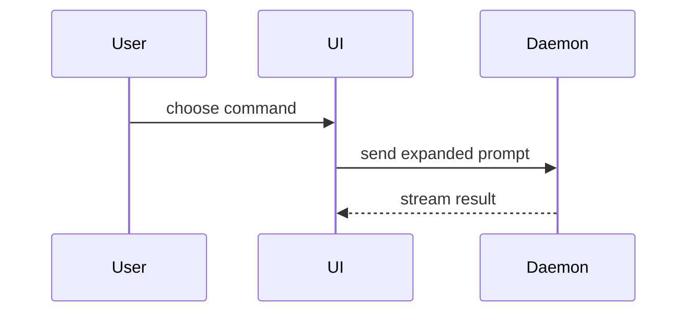

# PR body

Gate 9 writes the PR body from this template. The order is fixed so a reviewer knows where to look
for each thing: header block, then Summary, Evidence, Merge Danger, Review. Start at the header block;
keep prose brief.

```markdown
**Ticket:** [PROJ-210](https://<your-jira-host>/browse/PROJ-210)
<optional: Depends on #<PR> / Supersedes #<PR>>
<optional: Refs owner/repo#N>

## Summary

<one sentence: what changed and why>

<diagram, diff-sketch, or tree>

## Evidence

- **Before:** <screenshot/output/failing test run>
  **After:** <screenshot/output/passing test run>
- <proven live | only inspected> — <what was run or read>

<per-AC evidence table and parallel-pieces summary table, when intake supplies them>

## Merge Danger

**Door:** <one-way or two-way>

<optional: description>

**Blast Radius:** <who or what is affected if this is wrong>

<optional: potential ramifications of merge; applied-before-merge disclosure>

## Review

**Tier:** <Exempt — reason | Routine | Full>

<coverage-chain records>

**Delivered:** <active AC numbers this PR delivers>

**Not in this PR:** <known-open issues, deferred/skipped/out-of-scope AC>

<Intake: lines, spec issue or "sdlc-process: no tickets published", stub-doc content>
```

## Sections

Header block, first lines of the body: `**Ticket:**` per gate 7 (`**Ticket:** none — <reason>` when
there is none), then any PR this one depends on or supersedes, then any `Refs owner/repo#N` lines.
The two PR lines and the `Refs` lines are optional.

### Summary

Open with one sentence of what and why, then the smallest view that makes the key point clear. The visual
follows that one sentence directly. Use the repo's domain language: its glossary is `CONTEXT.md`, or
`GLOSSARY.md` where that is what the repo has.

- Show logic or an algorithm as pseudocode:

```text
on(save)
  if content is unchanged
    return cached result
  write new content
  return fresh result
```

- Show runtime control flow as a call tree:

```text
submitForm
  createSession
    persistPrompt
    launchAgent
  navigateToSession
```

- Show UI structure as a component tree, including state and module boundaries that matter:

```text
<SessionPage> (apps/example/src/routes/session.tsx)
  useSessionEvents()
  <SessionToolbar>
    <RunSkillButton> (packages/ui)
```

- Show file responsibility or a broad refactor as a shallow file tree:

```text
src/
├── commands/       # parses user actions
├── sessions/       # owns session state
└── transport/      # sends API requests
```

- Show component interaction, control flow, or data flow with Mermaid:



- Use `diff` when the point is what changes and the surrounding shape already exists. Match the diff shape to the topic.

For a component change:

```diff
 <SessionPage>
   useSessionEvents()
   <SessionToolbar>
+    <RunSkillButton />
   <SessionTimeline>
+    <SkillResultCard />
```

For a file-layout change:

```diff
 src/
 ├── commands/
+│   └── show-me.ts       # expands the slash command
 ├── sessions/
-└── transport.ts
+└── transport/
+    ├── client.ts
+    └── stream.ts
```

For a call-tree or call-stack change:

```diff
 submitForm
   createSession
     persistPrompt
+    expandSkillMention
     launchAgent
-  navigateToSession
+  navigateToSession
+    subscribeToEvents
```

For a state or control-flow change:

```diff
 on(save)
-  write content
+  if content is unchanged
+    return cached result
+  write new content
+  invalidate cache
```

- Show the whole block when most of it is new, when omitted context would hide ownership or order, or when the reviewer needs a copyable target shape:

```ts
function expandSkill(command: string): string {
  const skillName = command.slice(1);
  return `use the ${skillName} skill`;
}
```

#### Guidance

Place each visual next to the short text it supports. Keep only the calls, files, props, states, and
boundaries the reviewer needs to understand the change.

### Evidence

Concrete evidence that the change works. Show a before and an after.

Screenshots are S-tier, when the environment is set up for it and the change is visual.

Execution-based evidence is A-tier: test results, console output. Show the exact test that now fails
and passes, using pseudocode.

Label every item **proven live** (you ran it against the real thing) or **only inspected** (you read
the code or config). Never let an inspection pass for a run.

When the work came through `dev-workflow:intaking-work-items`, put its step-7 per-AC evidence table
here, and the parallel-pieces summary table when the run used orchestrating-pieces.

### Merge Danger

State whether the change is a one-way or two-way door. You can walk back through two-way doors, but
not one-way doors. A PR that is cheap to roll back is lower risk. Changes that involve destructive
actions or hard-to-reverse decisions are one-way doors.

State the blast radius: the potential impact or scope of the changes in this PR. Consider all
possibilities, such as breakage for consumers, layout shift, or who and what is affected if the change
is wrong.

When infrastructure was applied from this branch before merge, say so here (gate 10's
applied-before-merge disclosure): what was applied, where, and from which commit.

### Review

- **Tier:** the review tier from gate 5. `Exempt — <reason>` is allowed for flows that skip the review
  chain, such as investigating-incidents.
- **Coverage-chain records:** the gate 6 coverage-chain records showing the required reviews ran on this head.
- **Delivered:** the active AC numbers this PR delivers, per intake step 8.
- **Not in this PR:** known-open issues, and any acceptance criteria that were deferred, skipped or
  out of scope, so nothing is assumed delivered.
- **Intake lines:** each `Intake: …` skipped-step line from intake's step 8.
- **Spec issue:** the spec issue, or `sdlc-process: no tickets published`.
- **Stub doc:** when the user chose "no doc at all", the stub-doc content.
